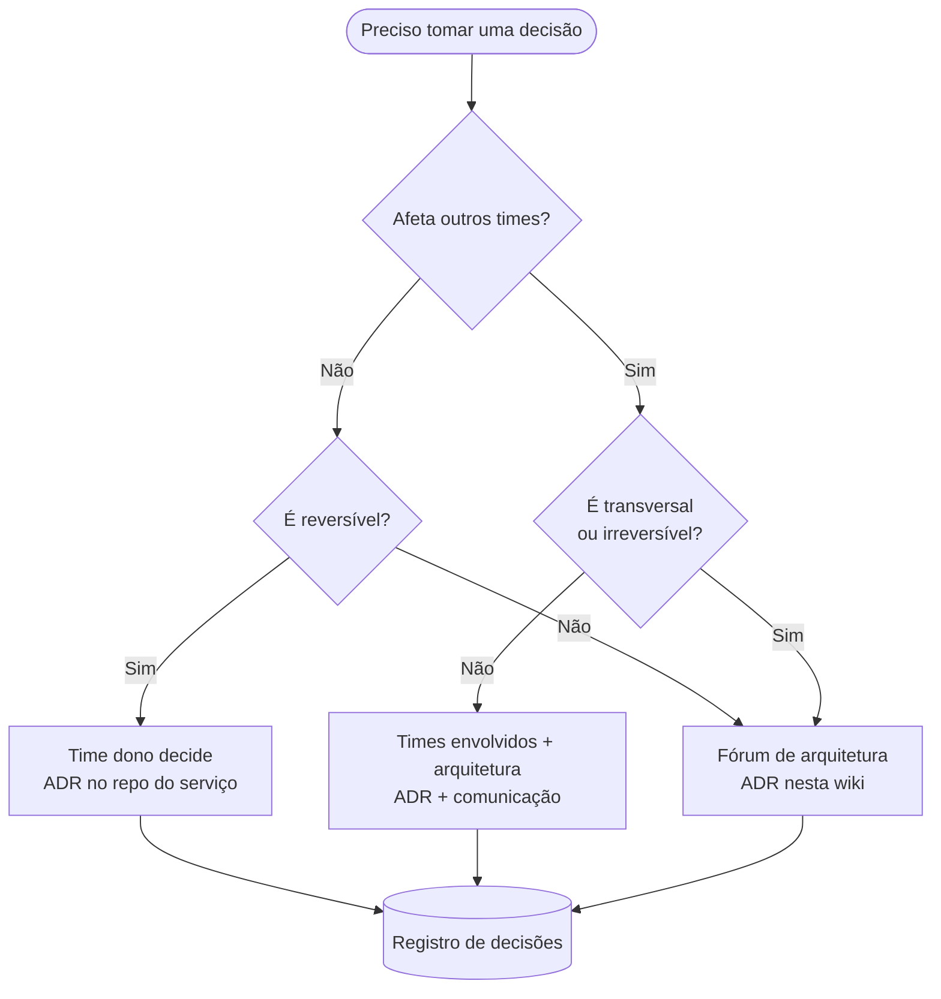

# Como decidimos

| Tipo de decisão | Quem decide | Registro |
|-----------------|-------------|----------|
| Local ao serviço, reversível | Time dono | ADR no repo do serviço |
| Afeta outros times | Times envolvidos + arquitetura | ADR + comunicação |
| Transversal ou irreversível | Fórum de arquitetura | ADR nesta wiki |

## Fluxo

1. Escreva o ADR como **proposto** e abra um PR.
2. Colete comentários por um prazo definido (ex.: 5 dias úteis).
3. Decida no fórum adequado; atualize o status para **aceito** ou **rejeitado**.
4. Comunique e registre no [registro de decisões](registro.md).
