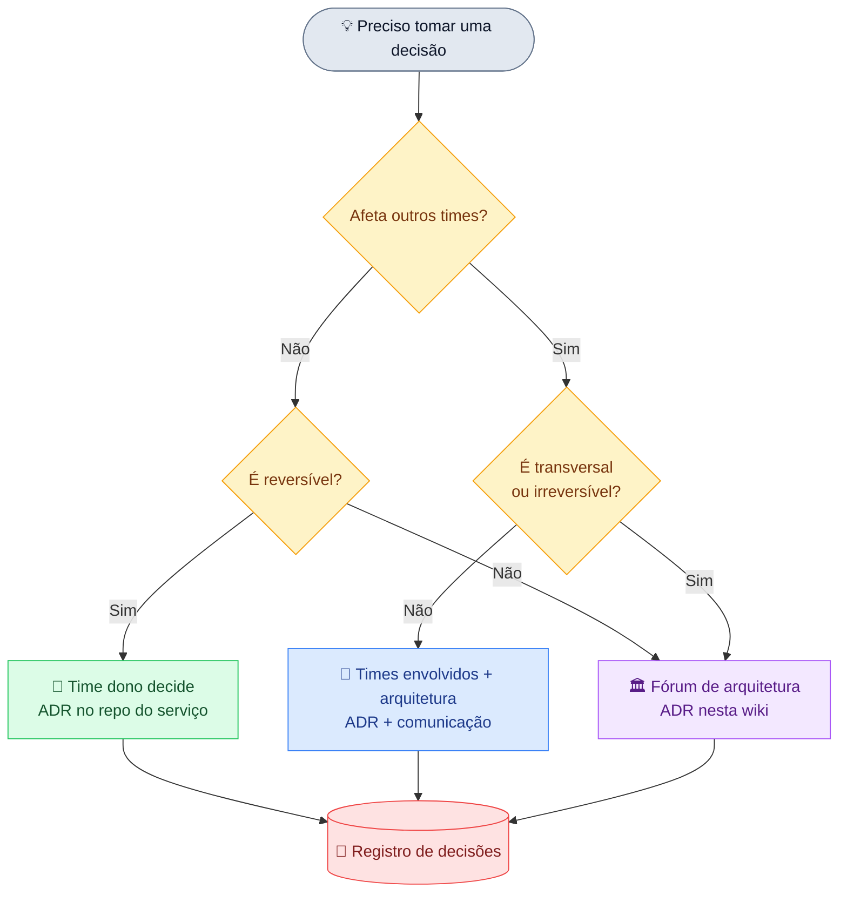
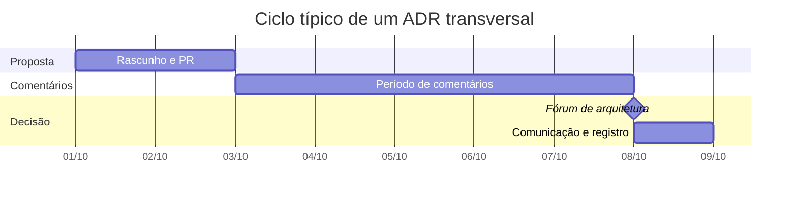

# Como decidimos

!!! abstract "Em uma frase"
    O tamanho do fórum acompanha o tamanho do impacto: o time decide o que é local, e a arquitetura
    decide o que é transversal ou irreversível.

*Figura 7 · Árvore de decisão: quem decide depende do alcance e da reversibilidade.*

| Tipo de decisão | Quem decide | Registro |
|-----------------|-------------|----------|
| Local ao serviço, reversível | Time dono | ADR no repo do serviço |
| Afeta outros times | Times envolvidos + arquitetura | ADR + comunicação |
| Transversal ou irreversível | Fórum de arquitetura | ADR nesta wiki |

## Do rascunho à decisão

*Figura 8 · Uma decisão transversal leva cerca de duas semanas, com prazo fixo de comentários.*

!!! tip "Na prática"
    1. Escreva o ADR como **proposto** e abra um PR.
    2. Divulgue o link e fixe o prazo de comentários.
    3. Decida no fórum adequado e atualize o status.
    4. Registre no [registro de decisões](registro.md).

**Leia também:** [Modelo de ADR](modelo-adr.md) · [Wiki de Governança](http://localhost:3000/docs/default/component/wiki-governanca)
