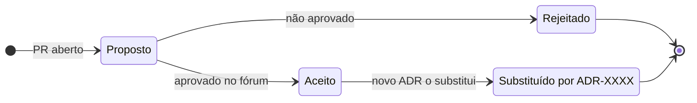

# Modelo de ADR

!!! abstract "Em uma frase"
    Um ADR é uma página curta: **contexto, opções, decisão e consequências**. Ele é escrito para quem
    vai ler daqui a dois anos.



*Figura 9 · Ciclo de vida de um ADR. Nada é apagado: decisões antigas são substituídas, não removidas.*

=== "📝 Modelo"

    ```markdown
    # ADR NNNN: Título curto da decisão

    - **Status:** proposto | aceito | rejeitado | substituído por ADR-XXXX
    - **Data:** AAAA-MM-DD
    - **Decisores:** pessoas/fóruns

    ## Contexto
    O problema e as forças em jogo (requisitos, restrições, prazos).

    ## Opções consideradas
    1. Opção A: prós / contras
    2. Opção B: prós / contras

    ## Decisão
    A opção escolhida e o porquê.

    ## Consequências
    O que fica mais fácil, o que fica mais difícil, o que precisa ser feito.
    ```

=== "✅ Exemplo preenchido"

    ```markdown
    # ADR 0002: PostgreSQL como banco relacional padrão

    - **Status:** aceito
    - **Data:** 2025-11-12
    - **Decisores:** fórum de arquitetura

    ## Contexto
    Cinco bancos relacionais diferentes em uso; custo alto de suporte e de backup.

    ## Opções consideradas
    1. PostgreSQL: maduro, extensível, serviço gerenciado nas clouds
    2. Manter a diversidade atual: zero esforço agora, custo crescente

    ## Decisão
    PostgreSQL para todos os serviços novos.

    ## Consequências
    + Um padrão de backup, monitoramento e tuning
    - Migração gradual dos legados (plano em ADR 0005)
    ```

!!! tip "Boas práticas"
    - **Uma decisão por ADR.**
    - Escreva as opções **rejeitadas**: é o que mais ajuda quem lê depois.
    - Uma página basta; detalhes vão em links.

**Leia também:** [Como decidimos](como-decidimos.md) · [Registro de decisões](registro.md)
