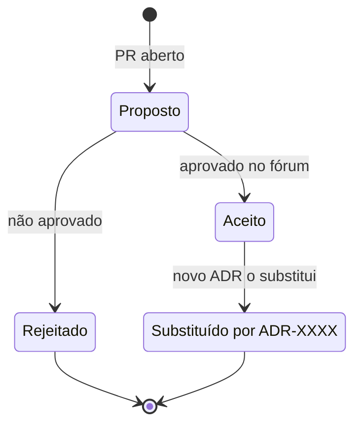

# Modelo de ADR

## Ciclo de vida



## Modelo

```markdown
# ADR NNNN: Título curto da decisão

- **Status:** proposto | aceito | rejeitado | substituído por ADR-XXXX
- **Data:** AAAA-MM-DD
- **Decisores:** pessoas/fóruns

## Contexto
O problema e as forças em jogo (requisitos, restrições, prazos).

## Opções consideradas
1. Opção A — prós / contras
2. Opção B — prós / contras

## Decisão
A opção escolhida e o porquê.

## Consequências
O que fica mais fácil, o que fica mais difícil, o que precisa ser feito.
```
