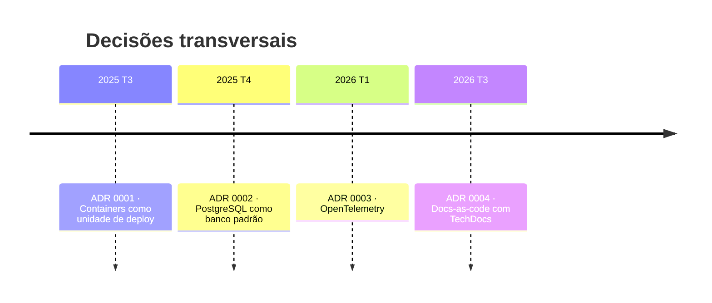

# Registro de decisões

| ADR | Título | Status | Escopo |
|-----|--------|--------|--------|
| 0001 | Containers como unidade de deploy | aceito | Transversal |
| 0002 | PostgreSQL como banco relacional padrão | aceito | Transversal |
| 0003 | OpenTelemetry para traces e métricas | aceito | Transversal |
| 0004 | Docs-as-code com TechDocs | aceito | Transversal |
| [demo-service 0001](http://localhost:3000/docs/default/component/demo-service/adr/0001-escolha-fastapi/) | Escolha do FastAPI | aceito | Serviço |

## Linha do tempo

