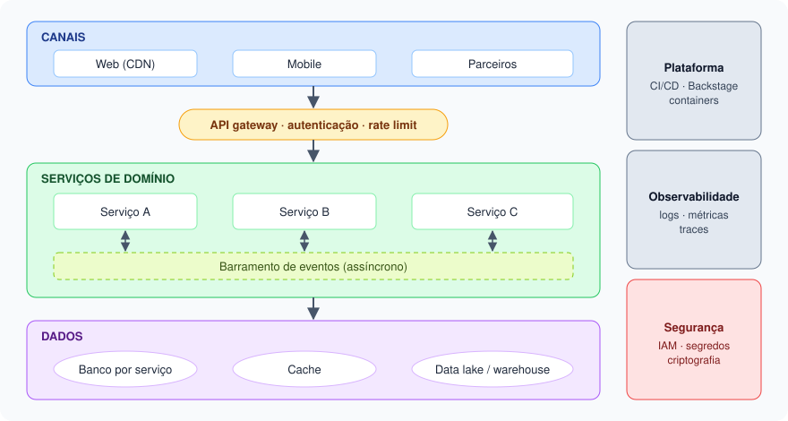

# Wiki de Arquitetura

**Os princípios, as decisões e os padrões que orientam como construímos e operamos software.**
Um ponto único de referência para times, tech leads e arquitetura.

[Visão executiva →](visao-executiva.md){ .md-button .md-button--primary }
[Princípios](visao-geral/principios.md){ .md-button }
[Registro de decisões](decisoes/registro.md){ .md-button }

<figure markdown>
  { width="100%" }
  <figcaption>Figura 1 · Arquitetura de referência: canais chegam aos serviços pelo gateway, serviços integram por eventos e têm dados próprios, e plataforma, observabilidade e segurança atravessam todas as camadas.</figcaption>
</figure>

## Em números

| 🧭 Princípios | 🏛️ Camadas | 📜 ADRs transversais | 🎯 SLO padrão |
|:---:|:---:|:---:|:---:|
| **7** | **3** | **4** | **99,9%** |

## Explore

-   🧭 __Visão geral__

    ---

    Princípios, camadas de integração e o radar de tecnologias.

    [Ver princípios →](visao-geral/principios.md)

-   ⚖️ __Decisões__

    ---

    Quem decide o quê, o modelo de ADR e o histórico de decisões.

    [Como decidimos →](decisoes/como-decidimos.md)

-   ⚙️ __Operação__

    ---

    Confiabilidade, resiliência, capacidade e custos.

    [Confiabilidade →](operacao/confiabilidade.md)

-   🛣️ __Na prática__

    ---

    Os golden paths aplicam esta wiki passo a passo.

    [Golden Path de Serviços →](http://localhost:3000/docs/default/component/golden-path-servicos)

!!! note "Conteúdo demonstrativo"
    Referência de arquitetura técnica para fins de exemplo. Adapte princípios e padrões às
    decisões aprovadas pelo fórum de arquitetura da organização.
