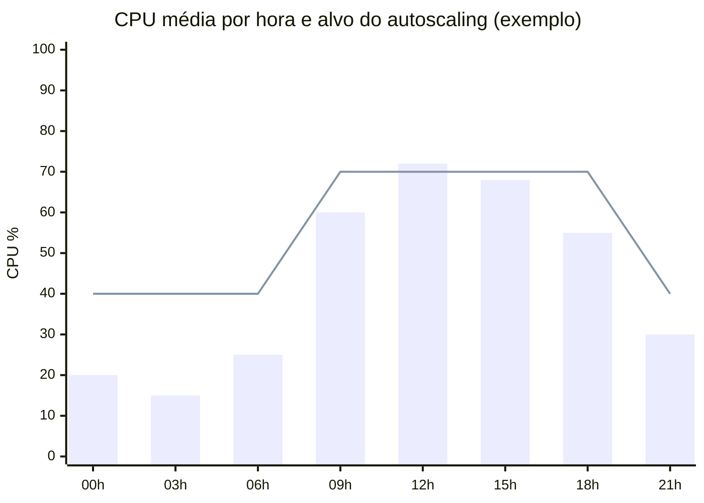

# Capacidade e custos

!!! abstract "Em uma frase"
    Dimensione por **medição**, escale automaticamente e dê a todo recurso um **dono** e uma **etiqueta
    de custo**.

*Figura 14 · Barras: CPU média; linha: alvo de utilização. Fora do horário comercial, o mínimo de
réplicas deixa a utilização baixa, e é aí que está a economia.*

-   📏 __Meça antes__

    ---

    Teste de carga define requests e limits, não a estimativa.

-   📈 __Escale sozinho__

    ---

    Autoscaling horizontal com mínimo e máximo definidos.

-   🏷️ __Etiquete tudo__

    ---

    `owner`, `system` e `ambiente` em todo recurso.

-   🔍 __Revise todo mês__

    ---

    Recursos ociosos e right-sizing na revisão mensal.

| Indicador | Meta |
|-----------|:----:|
| Utilização média de CPU | 40–70% |
| Recursos sem etiqueta de owner | 0 |
| Ambientes de dev desligados fora do horário | 100% |

**Leia também:** [Confiabilidade](confiabilidade.md) · [Princípios](../visao-geral/principios.md)
