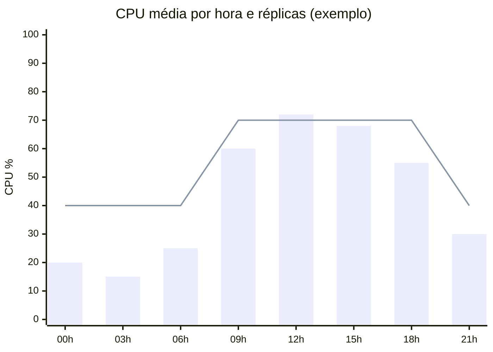

# Capacidade e custos

- Dimensione por **medição** (testes de carga), não por estimativa.
- Autoscaling horizontal com limites mínimo e máximo definidos.
- Requests e limits de CPU/memória declarados em todo workload.
- Tags de custo (`owner`, `system`, `ambiente`) em todos os recursos.
- Revisão mensal de recursos ociosos e de right-sizing.

| Indicador | Meta |
|-----------|------|
| Utilização média de CPU | 40–70% |
| Recursos sem tag de owner | 0 |

## Utilização x autoscaling

*Barras: CPU média; linha: alvo de utilização com autoscaling. Fora do horário comercial,
o mínimo de réplicas mantém a utilização baixa. É aí que mora a oportunidade de economia.*
