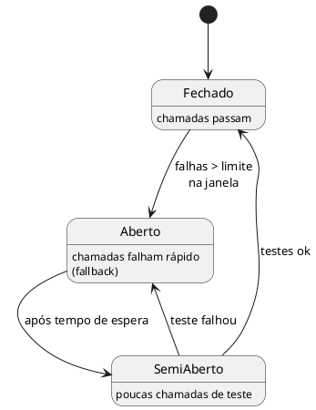
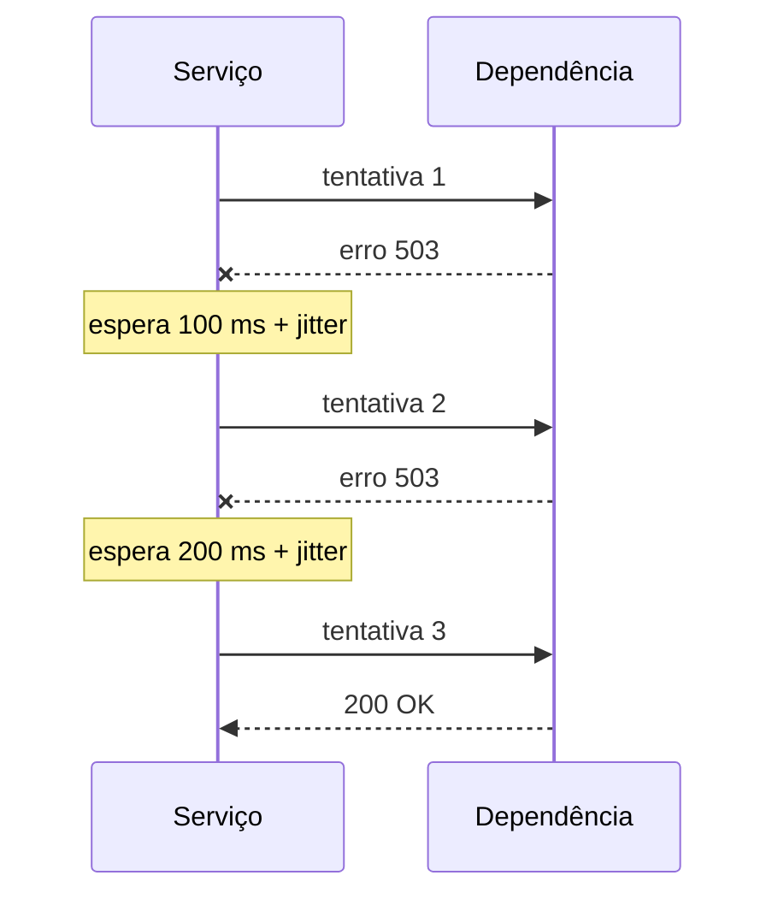

# Confiabilidade

## Requisitos mínimos por criticidade

| Criticidade | SLO de disponibilidade | Réplicas | Recuperação (RTO / RPO) |
|-------------|------------------------|----------|--------------------------|
| Alta | 99,95% | ≥ 3, multi-zona | 15 min / 5 min |
| Média | 99,9% | ≥ 2 | 1 h / 1 h |
| Baixa | 99% | 1 | 1 dia / 1 dia |

## Padrões de resiliência

- Timeouts em toda chamada remota.
- Retries com backoff exponencial e jitter, só para operações idempotentes.
- Circuit breaker para dependências instáveis.
- Degradação graciosa: o que o sistema faz quando a dependência cai?

### Circuit breaker

### Retry com backoff

