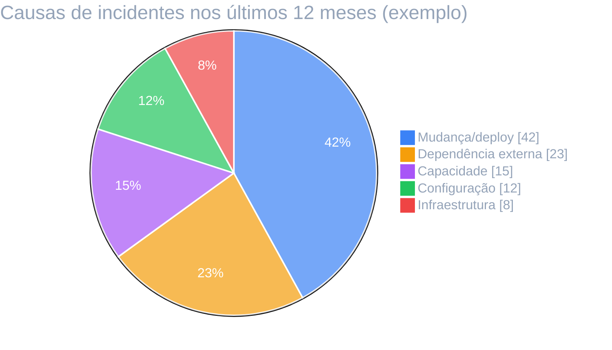
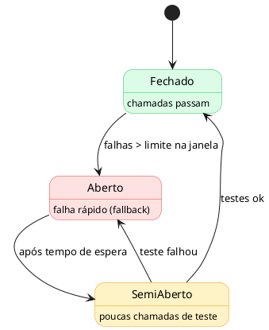
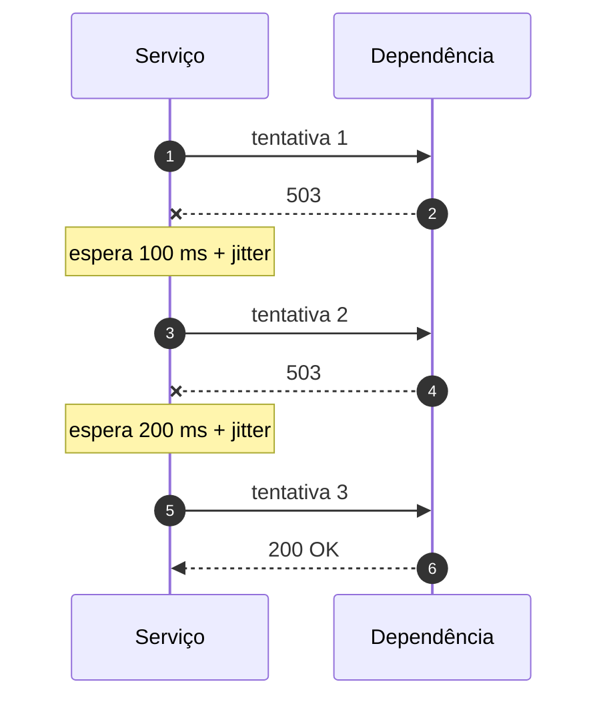

# Confiabilidade

!!! abstract "Em uma frase"
    A criticidade define o SLO, e o SLO define réplicas, recuperação e padrões de resiliência.
    Confiabilidade é **medida**, não presumida.

## Requisitos por criticidade

| Criticidade | SLO · parada/mês | Réplicas | RTO / RPO |
|-------------|:----------------:|:--------:|:---------:|
| 🔴 Alta | 99,95% · ~22 min | 3+ multi-zona | 15 min / 5 min |
| 🟡 Média | 99,9% · ~43 min | 2+ | 1 h / 1 h |
| 🟢 Baixa | 99% · ~7 h | 1 | 1 dia |

*Figura 11 · A maioria dos incidentes vem de mudanças, por isso deploy progressivo e rollback rápido são obrigatórios.*

## Padrões de resiliência

=== "⏱️ Timeout"

    Toda chamada remota tem timeout **menor** que o do chamador. Sem timeout, uma dependência
    lenta derruba quem a chama.

=== "🔁 Retry com backoff"

    Só para operações **idempotentes**, com backoff exponencial e jitter, e com limite de tentativas.

=== "🔌 Circuit breaker"

    Depois de N falhas, para de chamar a dependência por um tempo e usa um fallback.

=== "🪂 Degradação graciosa"

    Defina o que o sistema faz sem a dependência: cache, resposta parcial ou fila para depois.

### Circuit breaker

*Figura 12 · Estados do circuit breaker.*

### Retry com backoff

*Figura 13 · O intervalo dobra a cada tentativa; o jitter evita que todos os clientes tentem ao mesmo tempo.*

**Leia também:** [Capacidade e custos](capacidade-custos.md) · [Golden Path: observabilidade](http://localhost:3000/docs/default/component/golden-path-servicos/4-producao/observabilidade/)
