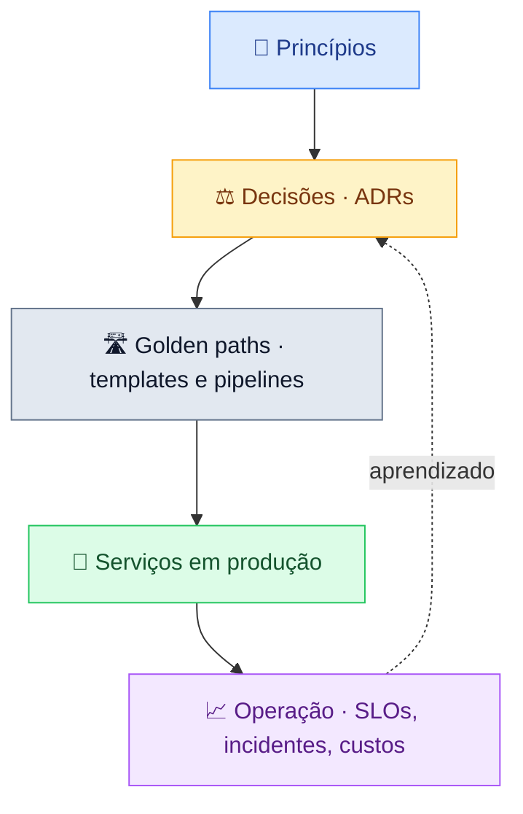

# Visão executiva

!!! abstract "Em uma frase"
    Sistemas com **dono claro**, integrados por **contratos**, **seguros e observáveis por padrão**,
    com decisões importantes **registradas** e um **caminho pavimentado** para colocá-los em produção.

## O modelo em uma figura

*Figura 2 · Do princípio à operação: o que aprendemos em produção realimenta as decisões.*

## Cinco mensagens

| | Mensagem | Por quê |
|---|----------|---------|
| 1 | **Todo sistema tem dono** no catálogo | Quem constrói, opera; ninguém fica sem resposta num incidente |
| 2 | **Integração só por contrato** | Times evoluem sem quebrar uns aos outros |
| 3 | **Segurança e observabilidade vêm prontas** | O golden path entrega; ninguém reinventa |
| 4 | **Decisão difícil de reverter vira ADR** | Contexto preservado; menos debates repetidos |
| 5 | **Confiabilidade é medida** (SLOs) | Prioridade técnica baseada em dados, não em opinião |

## Onde estamos

=== "Concluído"

    - ✅ Containers como unidade de deploy (ADR 0001)
    - ✅ PostgreSQL como banco relacional padrão (ADR 0002)
    - ✅ Docs-as-code com TechDocs (ADR 0004)

=== "Em andamento"

    - 🔄 OpenTelemetry em todos os serviços (ADR 0003)
    - 🔄 SLOs publicados para serviços de criticidade alta

=== "Próximos passos"

    - 🔜 Gateway de IA com governança centralizada
    - 🔜 Revisão trimestral de custos por sistema

!!! quote ""
    "Arquitetura é o conjunto de decisões que você gostaria de ter acertado logo no início."
    Ralph Johnson
