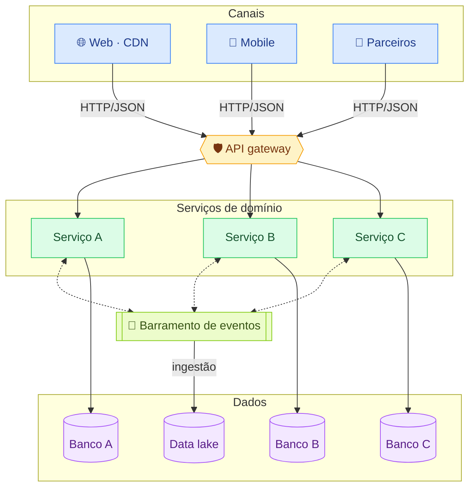
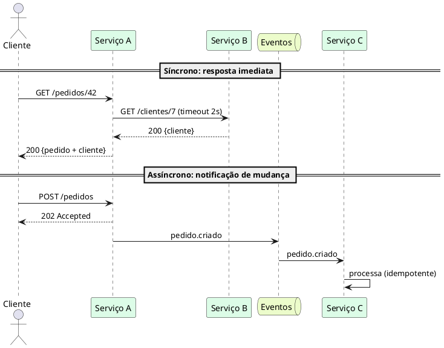

# Camadas e integrações

!!! abstract "Em uma frase"
    Três camadas (canais, domínio e dados) e três estilos de integração (síncrono, eventos e batch),
    sempre por contrato e nunca por banco compartilhado.

*Figura 4 · De cima para baixo: canais passam pelo gateway, cada serviço tem o próprio banco, os serviços conversam por eventos e os eventos alimentam o data lake.*

## Estilos de integração

=== "🔁 Síncrono (HTTP)"

    **Quando usar:** consulta que precisa de resposta imediata.

    | Faça | Evite |
    |------|-------|
    | Timeout em toda chamada | Cadeias longas de chamadas síncronas |
    | Retry com backoff, só se idempotente | Retry infinito |
    | Circuit breaker para dependência instável | Chamar o banco de outro serviço |

=== "📨 Assíncrono (eventos)"

    **Quando usar:** notificar uma mudança de estado a quem interessar.

    | Faça | Evite |
    |------|-------|
    | Consumidores idempotentes | Assumir ordem global |
    | Schema de evento versionado | Evento com o "banco inteiro" no payload |
    | Dead-letter queue monitorada | Ignorar mensagens com erro |

=== "📦 Batch"

    **Quando usar:** grandes volumes sem urgência.

    | Faça | Evite |
    |------|-------|
    | Janela e SLA definidos | Rodar em horário de pico |
    | Reprocessamento seguro | Arquivos sem checksum |

## Síncrono x assíncrono lado a lado

*Figura 5 · No síncrono o cliente espera a cadeia toda; no assíncrono ele recebe `202` e o trabalho segue por eventos.*

!!! danger "Banco compartilhado"
    Serviços **não** acessam o banco de outro serviço. Integração é sempre por contrato.

**Leia também:** [Princípios](principios.md) · [Confiabilidade](../operacao/confiabilidade.md)
