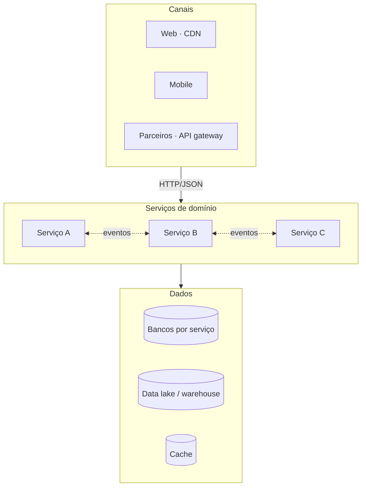

# Camadas e integrações

## Estilos de integração

| Estilo | Quando usar | Cuidado |
|--------|-------------|---------|
| Síncrono (HTTP) | Consulta com resposta imediata | Timeouts e retries com backoff |
| Assíncrono (eventos) | Notificar mudanças de estado | Idempotência e ordem |
| Batch | Grandes volumes sem urgência | Janela e reprocessamento |

!!! warning "Banco compartilhado"
    Serviços não acessam o banco de outro serviço. Integração é sempre por contrato.
