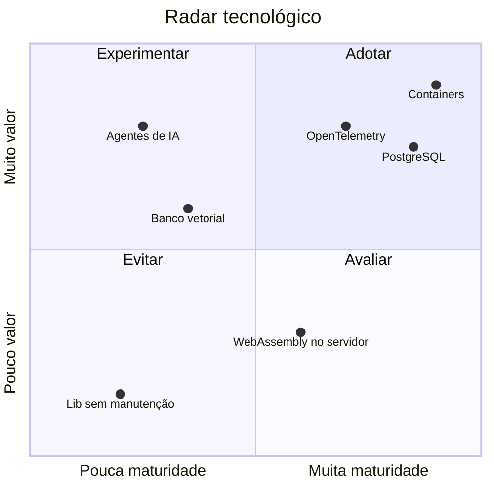

# Padrões tecnológicos

!!! abstract "Em uma frase"
    O radar diz o que **adotar**, **experimentar**, **avaliar** e **evitar**. Fora de "adotar" é
    possível, mas exige ADR.

*Figura 6 · Radar: valor para o negócio x maturidade da tecnologia na organização.*

=== "🟢 Adotar"

    Padrão suportado pela plataforma. Use sem pedir permissão.

    - Containers (Podman / Kubernetes)
    - PostgreSQL
    - OpenTelemetry
    - TechDocs (docs-as-code)

=== "🔵 Experimentar"

    Pode ir para produção com ADR e acompanhamento.

    - Agentes de IA com ferramentas restritas
    - Bancos vetoriais para busca semântica

=== "🟡 Avaliar"

    Estudo ou PoC, fora de produção.

    - WebAssembly no servidor

=== "🔴 Evitar"

    Não usar em projetos novos; planejar a saída nos existentes.

    - Bibliotecas sem manutenção
    - Runtimes fora de suporte

!!! tip "Na prática"
    Quer mover algo de quadrante? Escreva um ADR e leve ao fórum de arquitetura.

**Leia também:** [Como decidimos](../decisoes/como-decidimos.md) · [Registro de decisões](../decisoes/registro.md)
