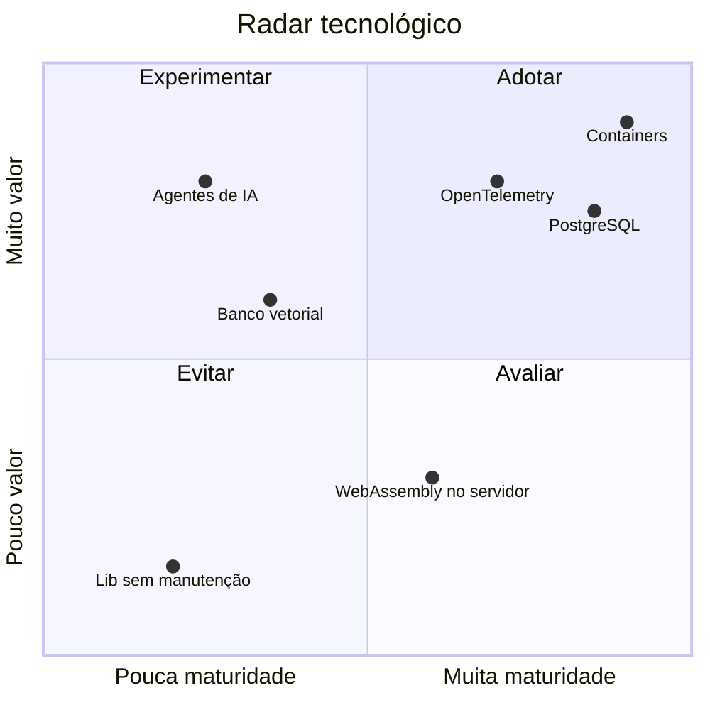

# Padrões tecnológicos

Radar simplificado de tecnologias:

| Situação | Significado | Exemplos |
|----------|-------------|----------|
| **Adotar** | Padrão; suportado pela plataforma | Containers (Podman/K8s), PostgreSQL, OpenTelemetry |
| **Experimentar** | Pode usar com ADR e acompanhamento | Novos frameworks, bancos especializados |
| **Avaliar** | Estudo/PoC, fora de produção | Tecnologias emergentes |
| **Evitar** | Não usar em novos projetos | Bibliotecas sem manutenção, runtimes fora de suporte |

Mudanças no radar passam pelo fórum de arquitetura e viram um ADR.
