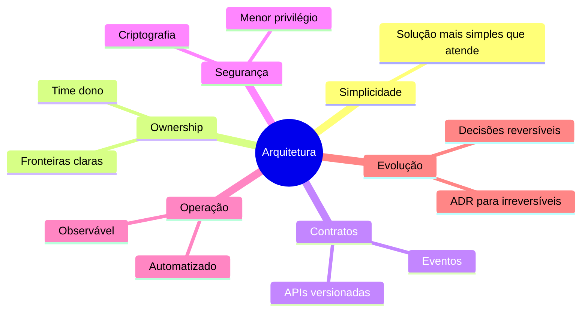

# Princípios

| # | Princípio | Implicação |
|---|-----------|------------|
| 1 | **Simplicidade primeiro** | Escolha a solução mais simples que atende ao requisito |
| 2 | **Domínios com dono** | Cada sistema tem um time dono e fronteiras claras |
| 3 | **Contratos explícitos** | Integrações por API/eventos versionados, registrados no catálogo |
| 4 | **Seguro por padrão** | Menor privilégio, criptografia em trânsito e em repouso |
| 5 | **Observável** | Logs, métricas e traces desde a primeira versão |
| 6 | **Automatizado** | Infraestrutura, pipeline e políticas como código |
| 7 | **Evolutivo** | Decisões reversíveis quando possível; irreversíveis exigem ADR |
