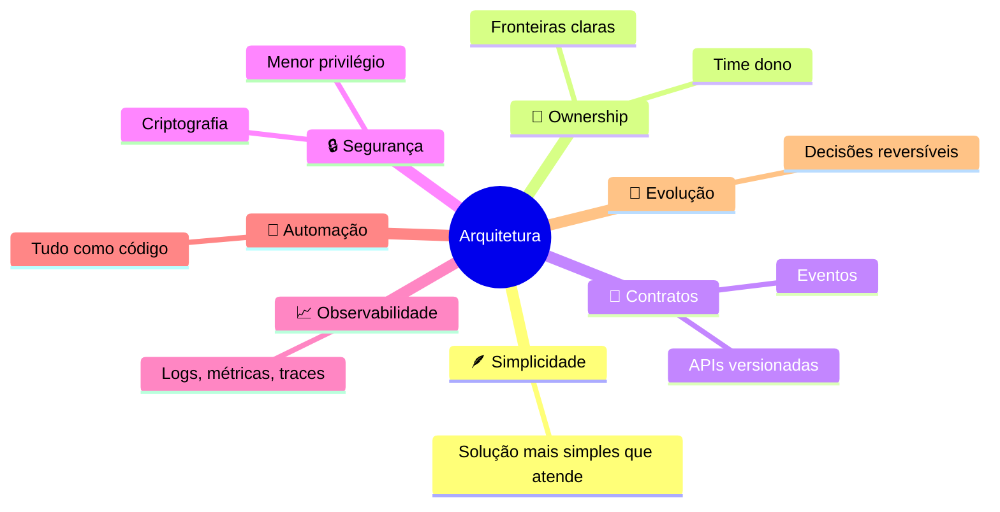

# Princípios

!!! abstract "Em uma frase"
    Sete princípios orientam toda decisão técnica. Quando dois entram em conflito, a decisão vira um
    [ADR](../decisoes/modelo-adr.md).

*Figura 3 · Os sete princípios e suas implicações principais.*

-   🪶 __1. Simplicidade primeiro__

    ---

    Escolha a solução mais simples que atende ao requisito de hoje, com espaço para o de amanhã.

-   👥 __2. Domínios com dono__

    ---

    Cada sistema tem um time dono no catálogo e fronteiras explícitas.

-   📄 __3. Contratos explícitos__

    ---

    Integração por API ou evento versionado, registrado no Backstage.

-   🔒 __4. Seguro por padrão__

    ---

    Menor privilégio, segredos em cofre, criptografia em trânsito e em repouso.

-   📈 __5. Observável desde o dia 1__

    ---

    Logs estruturados, métricas RED e traces antes do primeiro deploy.

-   🤖 __6. Tudo como código__

    ---

    Infraestrutura, pipeline, políticas, dashboards e alertas versionados.

-   🌱 __7. Evolutivo__

    ---

    Prefira decisões reversíveis; as irreversíveis exigem ADR.

!!! tip "Na prática"
    Ao revisar um design, percorra os sete princípios como checklist. Qualquer "não" precisa de
    justificativa escrita.

**Leia também:** [Camadas e integrações](camadas-integracoes.md) · [Como decidimos](../decisoes/como-decidimos.md)
